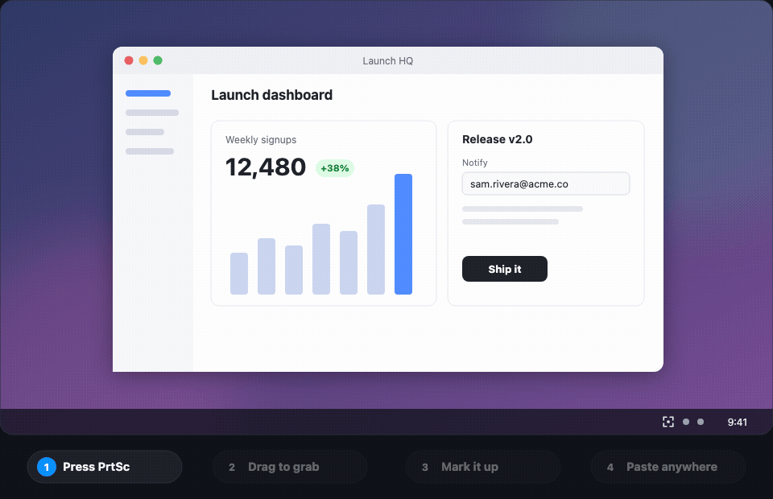

# Grab-it

### Screenshot it. Mark it up. Paste it anywhere.

**The fast, free screenshot tool for Windows, macOS and Linux.** 
One key to capture, a few clicks to explain, and it's already on your clipboard.

 

  

**[Get started in 2 minutes →](docs/getting-started.md)**

---

## Why Grab-it?

Explaining something on screen shouldn't take ten steps and three apps. With Grab-it it takes about three seconds:

1. **Press `PrintScreen`** (or `⌘ ⇧ 2` on a Mac).
2. **Drag** over what you want to share.
3. **Paste.** It's already on your clipboard.

Want to point something out first? Click **Annotate** on the little card that pops up and add arrows, boxes, numbered steps and notes. Blur the private bits, drop it on a gradient, and copy it.

## What you can do

<table>
<tr>
<td width="50%" valign="top">

### ⚡ Capture anything, instantly
Grab a region, a window, one monitor or all of them, with a magnifier for pixel-perfect selections. Need time to open a menu first? Use a timed capture.

</td>
<td width="50%" valign="top">

### ✏️ Explain it in seconds
Arrows, boxes, highlights, text and numbered steps, each one keystroke away. Spotlight the important part and crop out the rest.

</td>
</tr>
<tr>
<td valign="top">

### 🙈 Hide what's private
Blur or pixelate emails, names, tokens and anything else that shouldn't leave your screen.

</td>
<td valign="top">

### 🎨 Make it look good
One click puts your screenshot on a gradient with padding, rounded corners and a soft shadow. Ready for slides, docs and social posts.

</td>
</tr>
<tr>
<td valign="top">

### 🔍 Find any screenshot again
Search every capture by the words *inside* the image, or by app, tag and date. Text recognition runs on your computer, never in the cloud.

</td>
<td valign="top">

### 📌 Pin it, read it, record it
Float a screenshot above your windows as a reference. Copy text straight off the screen. Pick any colour. Record a quick GIF.

</td>
</tr>
</table>

## Get it

Grab-it is free and open source.

1. Download the installer for your computer from the **[latest release](https://github.com/kerwincarpede/grab-it/releases/latest)**.
2. Follow the **[Getting started guide](docs/getting-started.md)**. It covers installing on Windows, macOS and Linux, your first capture, and every shortcut.

| | |
| --- | --- |
| 📘 [Getting started](docs/getting-started.md) | Install Grab-it and take your first annotated screenshot |
| ⌨️ [Keyboard shortcuts](docs/getting-started.md#keyboard-shortcuts) | Every hotkey, on every platform |
| 🛟 [Troubleshooting](docs/getting-started.md#troubleshooting) | Fixes for the most common hiccups |
| 🛠️ [Developing Grab-it](docs/development.md) | Build from source, run the checks, and contribute |

## Contributing

Bug reports, ideas and pull requests are all welcome. [Open an issue](https://github.com/kerwincarpede/grab-it/issues) to get started, and see [Developing Grab-it](docs/development.md) to build it locally. Grab-it is made with Rust and [Tauri](https://tauri.app/).

## License

[MIT](LICENSE)
