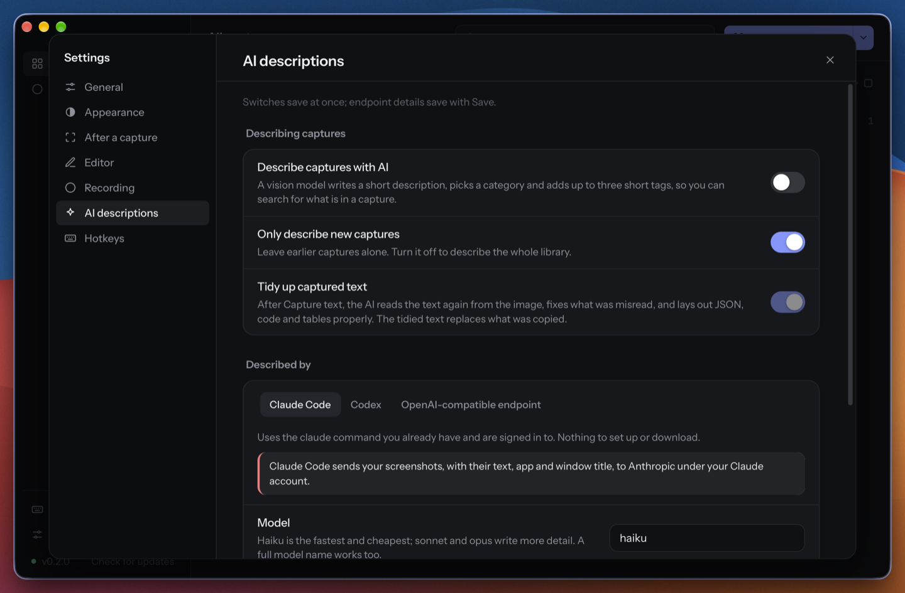

Pick who describes your captures in **Settings → AI integration → Described by**, then press **Save**. **Test connection** sends a tiny sample image, never one of your captures, with the settings as typed, without saving them. Settings shows where it goes before you press it. It tells you whether the server answered, took the request with the image, and replied with the JSON asked for, or what to fix. It can't tell whether the model looked at the image; see [When the test fails](#when-the-test-fails).



## Claude Code

Uses the `claude` command you already have and are signed in to. Nothing to set up or download.

- **Model**: `haiku` (the default) is the fastest and cheapest; `sonnet` and `opus` write more detail. A full model name works too.
- Grab-it finds `claude` even when it was started from Finder or a launcher, by asking your login shell for its `PATH`.
- It runs Claude Code in an empty temporary folder with no tools, so it can only look at the screenshot.
- Signing in is up to Claude Code. If it isn't signed in, describing stops and the Library shows its message. Run `claude` in a terminal to check.

If Settings says *Grab-it cannot find Claude Code*, install Claude Code and sign in, then reopen Settings.

## Codex

Uses the `codex` command you already have and are signed in to, the same way as Claude Code.

- **Model**: leave it empty to use the model set up in Codex itself, or type one.

## OpenAI-compatible endpoint

Any API that speaks OpenAI's `/chat/completions`, on your computer or in the cloud. Pick a **Preset** to fill in the URL and a suggested model, and Settings shows how to set that provider up. Type your own URL and the preset menu says *Custom*:

| Preset | Where it runs | Endpoint URL | Suggested model |
| --- | --- | --- | --- |
| LM Studio | This computer | `http://localhost:1234/v1` | `qwen/qwen3-vl-4b` |
| Ollama | This computer | `http://localhost:11434/v1` | `qwen3-vl:4b` |
| OpenRouter | Hosted, needs an API key | `https://openrouter.ai/api/v1` | `openai/gpt-5-mini` |
| OpenAI | Hosted, needs an API key | `https://api.openai.com/v1` | `gpt-5-mini` |
| Anthropic | Hosted, needs an API key | `https://api.anthropic.com/v1` | `claude-haiku-5-5` |

- **Endpoint URL**: such as LM Studio, Ollama, llama.cpp's server, or a cloud provider.
- **Model**: it must accept images. Type any model ID; it keeps the preset. **List models** asks the server which models it offers (its `/models`) and shows them under **Listed models**, where choosing one fills in **Model**. Embedding models are left out. Listing sends no image, and the list doesn't say which models accept images.
- **API key**: only cloud providers need one. Leave it empty for LM Studio and Ollama. It's kept in your system keychain (Keychain on macOS, Credential Manager on Windows, the Secret Service on Linux), for that endpoint's address only: change the endpoint and Grab-it asks for the key again. On a computer with no keychain Grab-it can use, Settings says it's kept in plain text in Grab-it's settings file instead.

These fields save only when you press **Save**. **Test connection** and **List models** save nothing.

### When the test fails

The message starts with what to fix:

- *The server did not answer*: the server isn't running, or the URL is wrong. Start LM Studio's server or Ollama, or check the URL.
- *The server did not accept the API key*: the key is missing, wrong or for another account.
- *… does not accept images*: the model reads only text. Choose a vision model.
- *The model's answer could not be used*: the model answered, but not with the JSON asked for. It may describe captures poorly; try a larger or newer model.
- *The model spent its whole reply budget thinking and sent no answer*: a reasoning model used every token on its reasoning. Grab-it already asks once more with a larger budget, and keeps using it for that model. If that runs out too, describing stops and the Library shows this message. Choose a model without reasoning, or turn reasoning off in the server.

After what to fix, *Details* gives the server's own words. Any other error shows the server's own message.

LM Studio and llama.cpp's server answer with whichever model is loaded, whatever model ID you type. A wrong ID doesn't fail the test there, and the preset's model ID is only a suggestion: replace it with the model you downloaded and loaded. Some servers pass the image to a text-only model without complaint, so a model that passes the test can still describe captures badly. If descriptions don't match your captures, choose a vision model.

### Run a model on your computer with Ollama

1. Install [Ollama](https://ollama.com).
2. Download the default model in a terminal:

   ```sh
   ollama pull qwen3-vl:4b
   ```

3. In **Settings → AI integration**, choose **OpenAI-compatible endpoint** and the **Ollama** preset, then **Test connection**.

The first answer can take a while as Ollama loads the model.

### Run a model on your computer with LM Studio

1. Install [LM Studio](https://lmstudio.ai) and download a vision model, such as Qwen3-VL 4B.
2. Load the model, then start the server in LM Studio's **Developer** tab. It listens on port 1234.
3. In **Settings → AI integration**, choose **OpenAI-compatible endpoint** and the **LM Studio** preset. Press **List models** and pick the model you loaded, then **Test connection**.

A reasoning model can take minutes to answer the test while it thinks: Qwen 3.8 27B took a few minutes. Settings shows *Testing…* until it answers.

### Use a hosted model with OpenRouter

1. Create an API key at [openrouter.ai/keys](https://openrouter.ai/keys).
2. In **Settings → AI integration**, choose **OpenAI-compatible endpoint** and the **OpenRouter** preset, and paste the key.
3. Keep the suggested model or press **List models** and pick one that takes image input, then **Test connection**.

OpenRouter receives your screenshots and passes them to the model's provider.

## What has been tested

These results come from running **List models** and **Test connection** in Grab-it against each server.

| Server | Model | What happened |
| --- | --- | --- |
| llama.cpp server 1.0.0, with the vision projector (`--mmproj`) | SmolVLM-500M | **List models** found the model. The image was accepted, but the model answered with other JSON (`{"url": …}`) instead of `{"ok": true}`, so the test failed with *The model's answer could not be used*. Why it ignored the instruction wasn't checked; the small model size is only a guess. |
| llama.cpp server 1.0.0, without the projector | SmolVLM-500M | The server answered 500 *image input is not supported*, and Grab-it said *… does not accept images. Choose a vision model.* |
| LM Studio, serving three chat models and `text-embedding-nomic-embed-text-v1.5` | `qwen/qwen3-vl-4b` typed in **Model** | **List models** said *Found 3 models. Choose one that accepts images under Listed models, or type its ID.* The menu offered `google/gemma-4-26b-a4b-qat`, `google/gemma-4-12b` and `qwen/qwen3.8-27b`, and left out the embedding model. Choosing one replaced the typed model ID. |
| LM Studio | Gemma 4 26B (`google/gemma-4-26b-a4b-qat`), reasoning | **Test connection** said *Connected: google/gemma-4-26b-a4b-qat at http://localhost:1234/v1 answered.* An earlier version, which gave the test 20 tokens, failed with an empty reply: LM Studio refused `response_format`, Grab-it retried without it, and the model spent the budget on reasoning. Sent by hand with the same prompt, the model answered `{"ok": true}` after 755 reasoning tokens, and gave nothing within 400. |
| LM Studio | Qwen 3.8 27B (`qwen/qwen3.8-27b`), reasoning | **Test connection** said *Connected: qwen/qwen3.8-27b at http://localhost:1234/v1 answered.* after a few minutes. The earlier 20-token version got an empty reply; sent by hand, it came back with empty content and `finish_reason` `length` after 19 reasoning tokens. |
| Ollama, not running | Any | **Test connection** said *The server did not answer. Check that it is running and that the URL is right.*, with *Details* saying the connection to `http://localhost:11434/v1/chat/completions` was refused. **List models** said *The server did not answer* too. |

The llama.cpp rows, and LM Studio answering for whichever model is loaded when given a wrong ID, come from an earlier version of these changes and weren't repeated on the latest one.

Not yet tried: Ollama running (its `/models` list, how it refuses images for a text-only model, and how it words a missing model); OpenAI, OpenRouter and Anthropic, including a wrong or missing API key. The *spent its whole reply budget thinking* message hasn't been seen from a real server, since both reasoning models above answered.

## What goes where

| Provider | Your screenshots, their text, app and window title go to |
| --- | --- |
| Claude Code | Anthropic, under your Claude account |
| Codex | OpenAI, under your ChatGPT or OpenAI account |
| Endpoint on this computer (`localhost` or `127.x`) | Nowhere. Nothing leaves your computer. |
| Cloud endpoint | That provider, under your API key |

Settings shows the same note under the provider you picked. With describing off, nothing is sent anywhere. See [Privacy](/grab-it/reference/privacy/) for everything else Grab-it does over the network.
