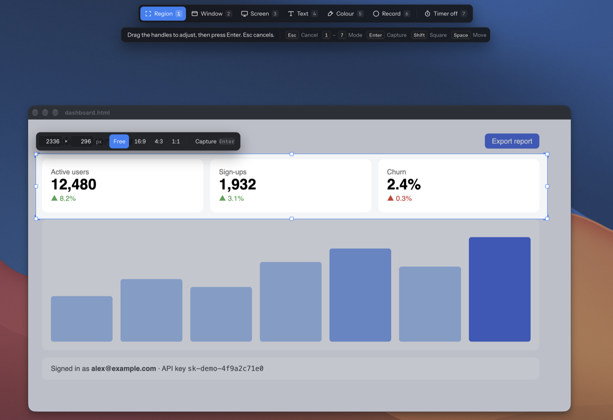

Open **Capture & record…** from the tray menu, the hub below **Capture region**, or **More captures** in the Library. Its global shortcut is `Ctrl + Alt + PrintScreen` by default (`⌘ ⇧ A` on macOS). The menus show the shortcut currently bound on your desktop.

The screen freezes with one toolbar at the top. Press the same shortcut again to cancel without capturing. A third press opens a fresh chooser.

## The toolbar

From left to right:

- **Capture**, **Record**, **Text**, **Colour** and **Scroll**: the five modes. A highlight slides to the one you pick, and only that one shows its name.
- The picked mode's own controls, which fold in as you switch: **Region**, **Window** and **Screen** for **Capture** and **Record**, the colour under the pointer in **Colour**, or the microphone, camera and **Recording options** in **Record**.
- **Timer** (the countdown in **Record**), then the main button, named for what it does: **Capture**, **Capture in 3 s**, **Copy text**, **Copy colour**, **Start scrolling** or a red **Record**. It's dimmed until there's something to act on. In **Window** and **Colour** it acts on the window or pixel you last paused on, so the pointer can cross the screen to reach it.
- **×** to cancel.

Point at any item, or move to it with `Tab`, to see a tooltip with its name, its key in the chooser, its global shortcut if it has one, and what it does. A dimmed main button's tooltip says what to do first, for example *Drag an area or click a window first.*

`Tab` moves into the toolbar and `←` `→` move between the buttons of a group. The first `Esc` leaves the toolbar; the next one cancels.

If a selected region is under the toolbar, the toolbar moves to the bottom edge of the screen. The selection's width, height and ratio sit in a chip under the region, not in the toolbar.

With **Reduce motion** on in your system settings, the toolbar's controls fade in and out instead of sliding and folding.

### From a Region capture

In a plain Region capture, with **Settings → Capture → Region toolbar** off, press `Tab` to bring up this toolbar on **Capture → Region**. A region you're dragging stays selected.

### A tick after a capture

Turn on **Settings → Capture → Show a tick in the toolbar after a capture** and Grab-it copies and saves the capture straight away, then the toolbar shows a green tick and what was done, such as *Copied · Saved to Library* (or *Saved to Library* with **Copy to clipboard** off), *Copied #8297FF*, or *Reading the text to copy* for **Text**, whose text is read once the overlay has gone. It shows for about a second before the overlay closes. It's off by default, since the Quick Access card already shows the result.

## Modes

Click a mode or target, or press its number while the chooser is open. You can switch as often as you like before you capture. `1`, `2` and `3` pick **Capture**'s targets (or **Record**'s, while it's on).

| Key | Mode | What it does |
| --- | --- | --- |
| `1` | **Capture → Region** | Drag a region, or click a window ([Region](/grab-it/capture/region/)) |
| `2` | **Capture → Window** | Click a window, or press `Enter` for the one under the pointer ([Window](/grab-it/capture/window/)) |
| `3` | **Capture → Screen** | Captures every monitor straight away, as it was frozen ([Screen and monitor](/grab-it/capture/screen/)) |
| `4` | **Text** | Drag over text or a code to copy it ([Text and codes](/grab-it/capture/text-and-codes/)) |
| `5` | **Colour** | Click a pixel, or press `Enter`, to copy the colour under the pointer ([Pick a colour](/grab-it/capture/colour/)) |
| `6` | **Record** | Choose what to record and start a recording (see below) |
| `7` | **Scroll** | Choose an area or window and stitch a [scrolling capture](/grab-it/capture/scrolling/) |
| `8` | **Timer** | Steps through off, 3, 5 and 10 seconds (see below) |

`Esc` or right-click cancels at any point.

## The Timer

The **Timer** button, beside the main button, shows its icon, and the delay once it's set, like *5 s*. Each click (or press of `8`) steps it on: off, 3 s, 5 s, 10 s, then off again. While it's set, the main button reads **Capture in 5 s**. It works with **Region**, **Window** and **Screen**, and is hidden for **Text**, **Colour** and **Scroll**. In **Record**, `8` steps the recording's countdown instead, which is in **Recording options**.

With the Timer on, you pick the area first. The overlay then closes, and when the time is up Grab-it captures that area **as the screen looks then**. Handy for opening a menu inside the area you chose. See [Timed capture](/grab-it/capture/timed/).

## Adjust the selection

In **Region** and **Text**, a region you drag doesn't capture when you let go. It stays selected so you can get it just right, and the main button lights up.

| To | Do this |
| --- | --- |
| Resize it | Drag a handle on any corner or edge |
| Move it | Drag inside it |
| Start over | Drag anywhere outside it |
| Pick a window instead | Click outside it to let it go, then click a window |
| Capture it | Press `Enter`, or the **Capture** button in the toolbar (**Copy text** in Text mode) |

`Shift` keeps a new drag square and `Space` moves it while you drag, as for a [region](/grab-it/capture/region/).

### Size and ratio

A chip under the selection's bottom-left corner shows its size, such as *1552 × 700 px*, in the pixels the capture will have, so on a Retina or high-DPI screen it's the real image size, not the size in points.

### Ratio locks

The chip's ratio menu offers **Free**, **16:9**, **4:3** and **1:1**. Pick a ratio and the selection is reshaped to it around its centre, as large as its width allows. While a ratio is locked, dragging a handle keeps that shape: a corner grows from the opposite corner, and an edge from the opposite edge. **Free** unlocks it again.

## Your last region

The last region you captured starts out selected on the monitor it was on, ready to capture again with `Enter`, or to adjust first. Drag anywhere else for a new one, or click away to let it go, then click a window to pick it instead.

## Record

**Record** stays in the same toolbar, with a red dot on its icon. While it's on:

- **Region**, **Window** and **Screen** (or `1`, `2` and `3`) pick what to record. A region keeps its size and ratio chip under it.
- The microphone and camera buttons each list **Default**, your devices and **Off**. The microphone button shows its level as you speak. **Recording options** holds the format, countdown, microphone, camera, and switches for system sound, noise removal, clicks and keystrokes. See [Recording options](/grab-it/recording/options/).
- The countdown is in **Recording options**, and its seconds show on that button once it's set. `8` steps it.
- The main button is a red **Record**. Press it or `Enter` to start.

Press **Record** or `6` again to go back to screenshots, or pick another tool. Press the Capture & record… shortcut again to stop the recording. See [Record your screen](/grab-it/recording/record/).

## Scroll

Choose **Scroll**, drag an area or click a window, then press **Start scrolling** or `Enter`. A guide panel walks you through it and lets you choose who scrolls. See [Scrolling capture](/grab-it/capture/scrolling/).
