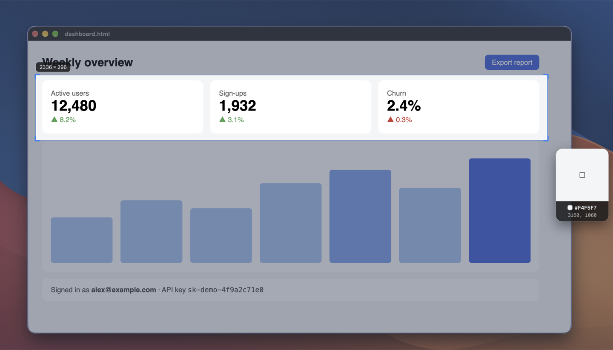

**Capture region** is the capture you'll use most. Press `PrintScreen` (on macOS `⌘ ⇧ 2`), or pick **Capture region** in the tray menu.

Every monitor freezes at once and dims, so menus, tooltips and videos stay exactly as they were. Each monitor gets its own overlay, so you can drag on whichever one you like.

## Drag a region

1. Press down where one corner should go and drag to the opposite corner. The size of the selection, in the pixels the capture will have, shows beside it.
2. Let go. The region is captured.

While you drag:

| Key | What it does |
| --- | --- |
| `Shift` (hold) | Keeps the selection square |
| `Space` (hold) | Moves the whole selection instead of resizing it, then let go of `Space` to carry on resizing |
| `Esc`, or right-click | Cancels; nothing is captured |

A hint at the top of the screen lists these keys too.

## The magnifier

A magnifier follows your pointer. It shows the pixels around it, enlarged, with the pixel under the pointer marked in the middle, its colour as a hex code and its position. Use it to start and end a selection on exactly the right pixel.

## Or click a window

A press that barely moves (less than a few pixels) is a click, not a drag. Hovering highlights the window under the pointer; click it to capture that window as it looked when the screen froze. See [Window](/grab-it/capture/window/).

## What you get

The capture is copied, saved and shown on the [Quick Access card](/grab-it/capture/first-capture/#the-quick-access-card), as every capture is. Grab-it also remembers the area, so [Repeat last region](/grab-it/capture/repeat/) can capture it again, and [Capture & record…](/grab-it/capture/all-in-one/) offers it as its starting selection.

On monitors with different scale factors (a Retina laptop next to a regular screen, say), each region is captured at its own monitor's full resolution.

:::note
On Wayland your desktop's own screenshot picker shows instead of Grab-it's overlay. See [Wayland](/grab-it/capture/wayland/).
:::
