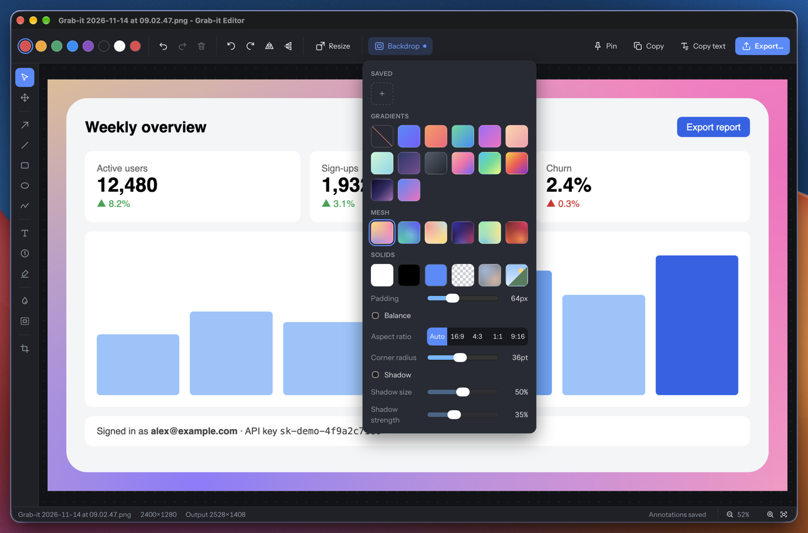

A **Backdrop** puts your screenshot on a background, with padding around it, rounded corners and a soft shadow. Perfect for slides, docs and social posts.

Click **Backdrop** in the top bar and pick a background. That turns it on; the button stays highlighted while it's on. Pick **No backdrop** (the first swatch) to turn it off again.

## Backgrounds

| Group | Choices |
| --- | --- |
| **Saved** | Backdrops you've saved, see [Presets](#presets) |
| **Gradients** | Ocean, Sunset, Aurora, Grape, Peach, Mint, Dusk, Slate, Flamingo, Lagoon, Ember and Nebula, plus a **custom gradient** |
| **Mesh** | Bloom, Tide, Sorbet, Midnight, Meadow and Glow: soft blobs of colour |
| **Solids** | White, Black, any colour from the picker, **Transparent**, **Blurred capture** and **Image** |

- The **custom gradient** shows a start colour, an end colour and an **Angle** (0 to 359°) to mix your own.
- **Transparent** keeps the shape, corners and shadow with nothing behind them. Export as PNG, WebP or TIFF to keep the transparency.
- **Blurred capture** uses a blurred copy of your screenshot as its own background.
- **Image** asks for a PNG, JPEG, WebP or GIF to use as the background.

## Layout

| Setting | Range | What it does |
| --- | --- | --- |
| **Padding** | 0 to 200 px (64 to start with) | The space around the screenshot |
| **Balance** | on or off | Pads unevenly, so a screenshot with empty margins of its own looks centred |
| **Aspect ratio** | Auto, 16:9, 4:3, 1:1, 9:16 | **Auto** pads evenly; the others pad the result out to that shape |
| **Corner radius** | 0 to 80 pt (36 to start with) | Rounds the screenshot's corners. In points, so it looks the same on a Retina screenshot |
| **Shadow** | on or off (on to start with) | A soft shadow under the screenshot |
| **Shadow size** | 0 to 100% | How far the shadow spreads |
| **Shadow strength** | 0 to 100% | How dark it is |

Moving a slider shows the result as you drag; letting go is one step you can undo. With a [crop](/grab-it/image-editor/crop/), the backdrop goes around the cropped area. The status bar shows the **Output** size.

## Presets

Made a backdrop you like? Click **+** (**Save as preset**) at the end of the **Saved** row. It's saved as *Preset 1*, *Preset 2* and so on, and shows in every editor window from then on. While a saved preset is in use, its name shows under the row: type to rename it, or **Delete** it (the screenshot keeps its backdrop). You can keep up to 24.

## A backdrop on every capture

New backdrops start from the last one you picked. To go one step further, turn on **Frame new captures with the last backdrop** in [Settings](/grab-it/reference/settings/). Then a capture opened in the editor for the first time gets your last backdrop straight away. The saved capture and its clipboard copy stay unframed; the backdrop is added when you copy or export from the editor.
