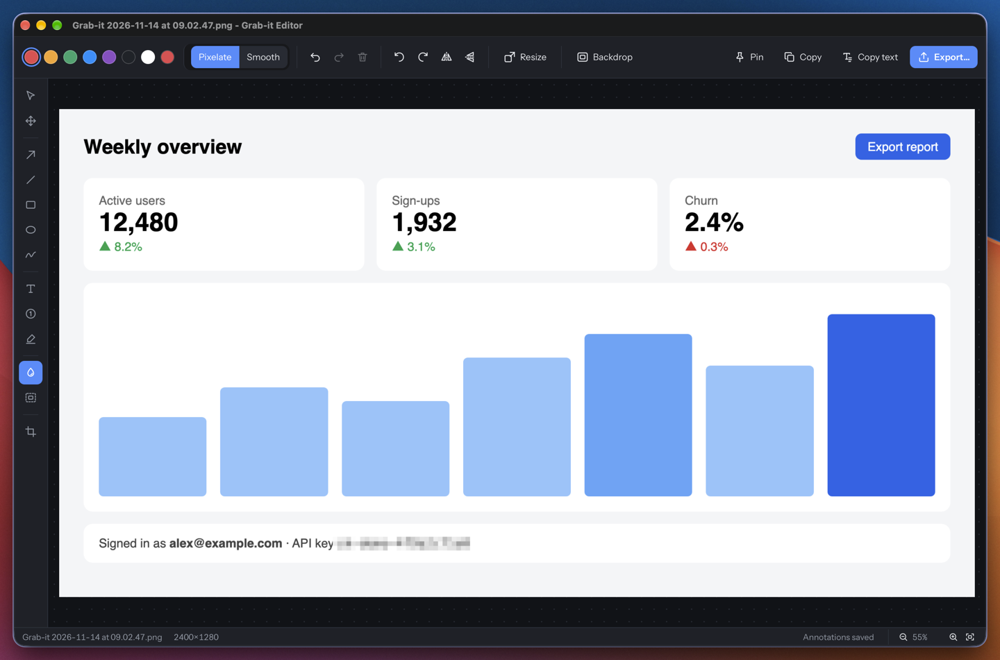

**Key: `B`**

Drag a box over anything you don't want to share. Everything under it is hidden. Hold **`Shift`** for a square.

## Pixelate or Smooth

The top bar has two styles:

| Style | Looks like |
| --- | --- |
| **Pixelate** (the default) | Large blocks of colour |
| **Smooth** | A soft blur |

Switch with a blur selected to change it, or before you draw to change the next ones. Blur has no colour or width.

:::tip
Blur hides the screenshot underneath it. Anything you draw after the blur sits on top of it and stays sharp, so you can blur an email address and still label it.
:::

The blur is applied when you copy or export. Your original screenshot is never changed, so you can always move or remove a blur later. See [Your original is safe](/grab-it/image-editor/non-destructive/).
