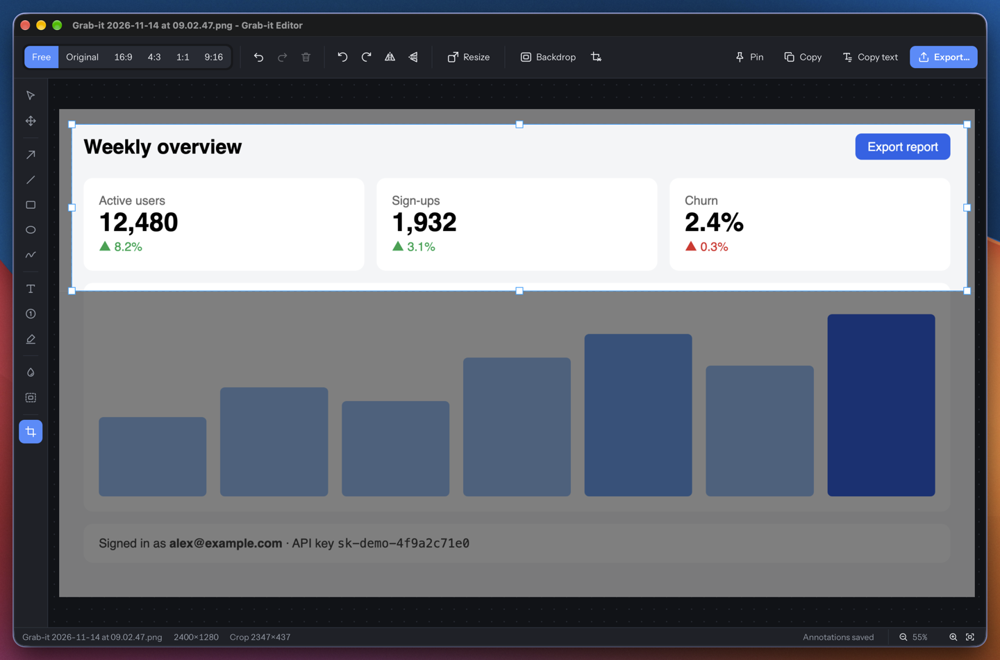

**Key: `C`**

Drag over the part you want to keep. Everything outside it is dimmed, and left out when you copy or export.

## Ratios

With Crop picked, the top bar shows ratios instead of colours:

| Ratio | Shape |
| --- | --- |
| **Free** | Any shape; hold `Shift` for a square |
| **Original** | The screenshot's own shape |
| **16:9**, **4:3**, **1:1**, **9:16** | Widescreen, classic, square and portrait |

Picking a ratio reshapes a crop you've already drawn to the largest box of that shape inside it. The ratio is for this editing session only.

## Adjust it

While Crop is picked, the crop has handles:

- **Drag inside it** to move it.
- **Drag a handle** to resize it. With a ratio, only the corner handles show, and the crop keeps its shape.
- **Draw a new one** by dragging outside it.
- **Reset crop**, in the top bar, removes it.

## Snapping

Crop edges snap to the screenshot's borders and to strong edges inside it, such as window borders, panels and toolbars, so cropping to a window inside a screenshot lines up exactly. Hold **`Alt/⌥`** while you drag to crop without snapping.

The status bar shows the crop's size. When a [backdrop](/grab-it/image-editor/backdrop/) is on, the backdrop goes around the cropped area; the Crop tool shows the whole screenshot meanwhile, so you can redraw it.

Cropping never throws anything away: reset it any time. See [Your original is safe](/grab-it/image-editor/non-destructive/).
