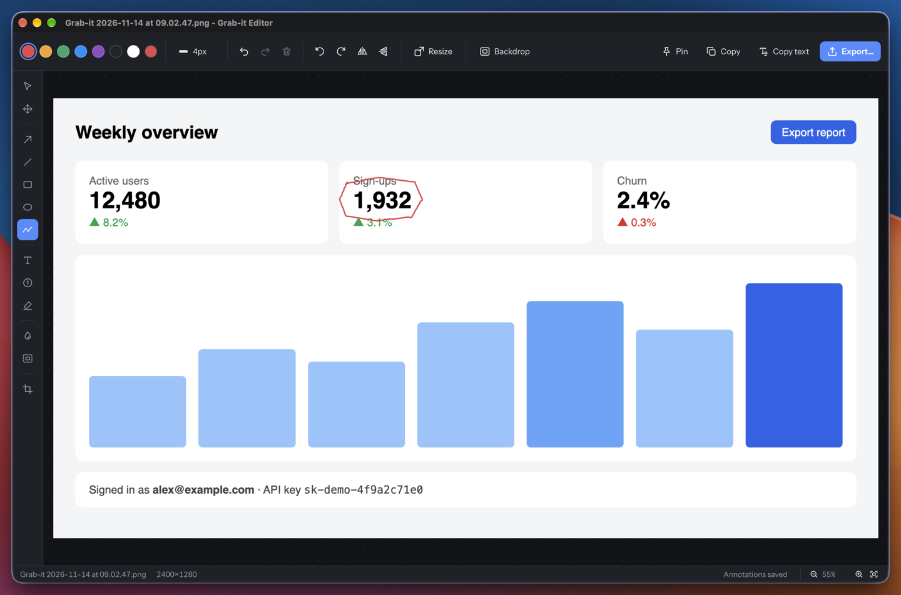

**Key: `P`**

Drag to draw; the line follows the pointer wherever it goes. When you let go, Grab-it smooths the line, so a shaky hand still draws a clean stroke. A single click leaves a dot.

**Options:** colour, and a width from 1 to 24 pixels. See [Colours and sizes](/grab-it/image-editor/styles/).

Want it straight? Use [Line](/grab-it/image-editor/line/) with `Shift` instead.
