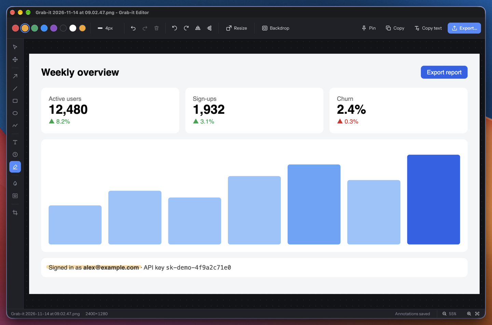

**Key: `H`**

Drag over text to highlight it, like a highlighter pen. Pick orange or green from the colours for the classic look, or choose yellow from the colour picker on the last swatch.

The highlighter is always drawn wider than the width you pick: three times as wide, and never thinner than 18 pixels, so it covers a line of text. Change it with **Width**, `[` and `]`, or `Alt/⌥ + scroll`.
