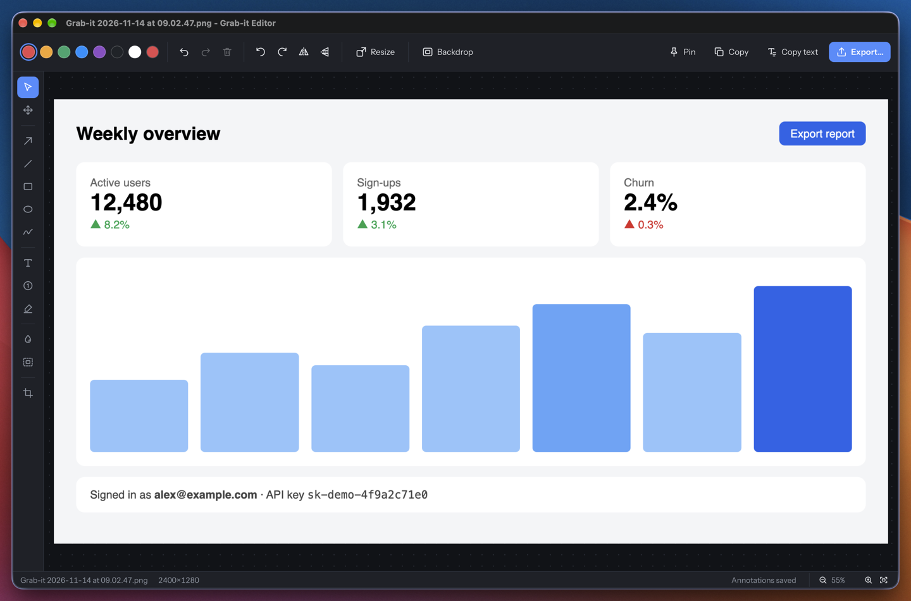

Click **Annotate** on the Quick Access card or a pin, or open a capture from the [Library](/grab-it/library/), and the editor opens. Set **After a capture** to the editor in [Settings](/grab-it/reference/settings/) to go straight there after every capture.

- [Mark it up](/grab-it/image-editor/mark-it-up/): a tour of the editor, and every key.
- [Colours and sizes](/grab-it/image-editor/styles/): colours, widths, fills and the options each tool has.
- One page per tool: [Select](/grab-it/image-editor/select/), [Pan](/grab-it/image-editor/pan/), [Arrow](/grab-it/image-editor/arrow/), [Line](/grab-it/image-editor/line/), [Rectangle](/grab-it/image-editor/rectangle/), [Ellipse](/grab-it/image-editor/ellipse/), [Freehand](/grab-it/image-editor/freehand/), [Text](/grab-it/image-editor/text/), [Callout](/grab-it/image-editor/callout/), [Step](/grab-it/image-editor/step/), [Stamp](/grab-it/image-editor/stamp/), [Highlighter](/grab-it/image-editor/highlighter/), [Blur](/grab-it/image-editor/blur/), [Spotlight](/grab-it/image-editor/spotlight/), [Crop](/grab-it/image-editor/crop/) and [Cut out](/grab-it/image-editor/cut-out/).
- [Pointer](/grab-it/image-editor/pointer/): show, hide, move or resize the mouse pointer.
- [Add images](/grab-it/image-editor/add-images/): drop or paste more screenshots onto one, such as a before and after.
- [Backdrop](/grab-it/image-editor/backdrop/): gradients, padding, corners and shadows.
- [Rotate, flip and resize](/grab-it/image-editor/rotate-flip-resize/).
- [Copy, export and pin](/grab-it/image-editor/share/).
- [Your original is safe](/grab-it/image-editor/non-destructive/): how edits are saved, and changed later.

Your edits are saved automatically and you can change them any time. The original screenshot is never altered.

## Step through your captures

Click **Previous capture** or **Next capture**, the arrows at the right of the top bar, to open the neighbouring capture in the same window. Press `←` or `→` to do the same. When an annotation is selected, the plain arrows nudge it, and `⌥ ←` or `⌥ →` (`Alt ←` or `Alt →` on Windows and Linux) steps through captures. Your edits are saved first, and undo starts again for each capture.

They step through every screenshot in the [Library](/grab-it/library/), newest first, whatever the Library is showing. Recordings and GIFs are skipped. If the capture is already open in another editor window, that window comes to the front instead. A file opened from outside the Library has both arrows turned off.
