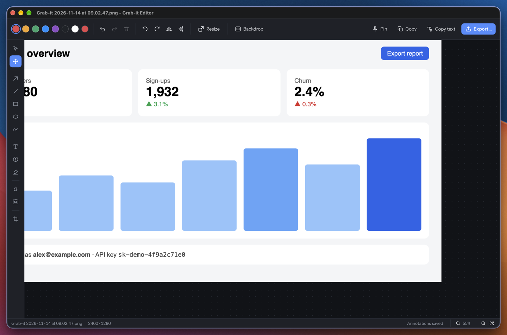

**Key: `M`**

With Pan, dragging moves the whole view, so you can get around a screenshot you've zoomed into. Nothing you've drawn moves.

You rarely need to pick it: **hold `Space`** with any tool and drag to pan, then let go of `Space` to carry on drawing.

To zoom, scroll over the screenshot (it zooms around the pointer), or use **Zoom out**, **Zoom in** and **Fit** in the status bar. See [Zoom](/grab-it/image-editor/mark-it-up/#zoom).
