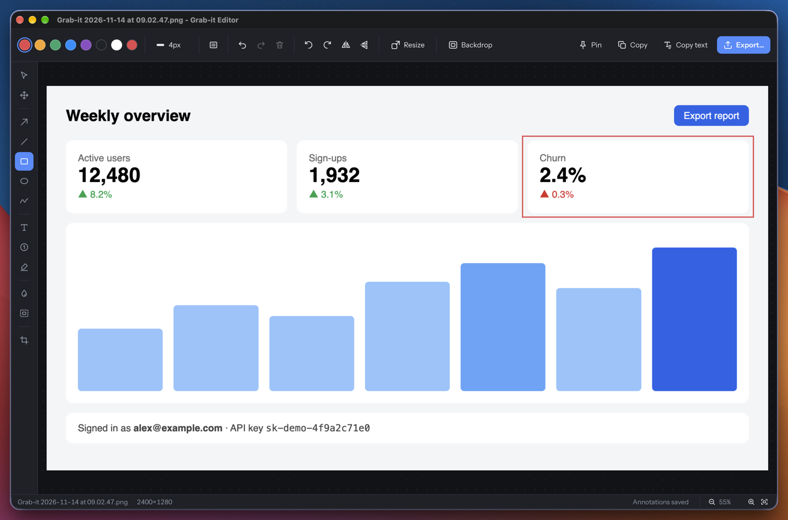

**Key: `R`** · also `Ctrl/⌘`-drag with any tool

Drag from one corner to the opposite one. Hold **`Shift`** for a perfect square.

## Options

| Option | What it does |
| --- | --- |
| Colour | The outline, and the fill |
| Width | The outline's thickness, 1 to 24 pixels |
| **Fill** | Fills the box with its colour, see-through so what's underneath still shows |

**Fill** appears in the top bar while Rectangle (or a rectangle) is selected. Like every option, it applies to the selected rectangle and to the next ones you draw.

Since `Ctrl/⌘`-drag draws a rectangle from any tool, you can box something in without leaving the tool you're on.
