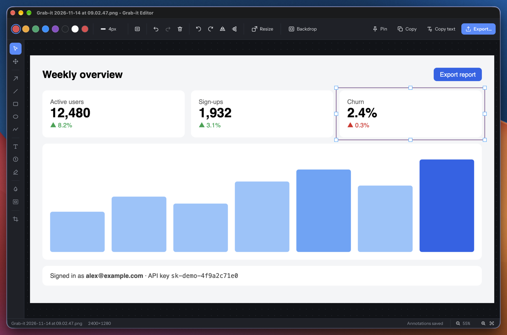

**Key: `V`**

Select is for changing what you've already drawn. Click a shape to select it; click an empty part of the screenshot to deselect.

A selected shape shows handles:

- **Drag the shape** to move it.
- **Drag a handle** to resize it. Text, step badges and stamps resize from their corners only, keeping their shape.
- **Stamps** also have a handle that turns them. See [Stamp](/grab-it/image-editor/stamp/).
- **Arrows and lines** have their own handles instead: one on each end, and one in the middle that bends the line into a curve. See [Arrow](/grab-it/image-editor/arrow/).

With a shape selected:

| To | Do this |
| --- | --- |
| Change its colour, width or options | Pick them in the top bar, or press `1`–`7`, `[` or `]` |
| Nudge it | Arrow keys: 1 pixel, or 10 with `Shift` |
| Duplicate it | `Ctrl/⌘ + D`: the copy lands a little down and to the right, selected |
| Delete it | `Delete`, `Backspace`, or the trash button in the top bar |
| Bring it forward or send it backward | **Bring forward** and **Send backward** next to the trash button, or `Ctrl/⌘ + Alt + ]` and `Ctrl/⌘ + Alt + [` |
| Deselect it | `Esc` |

You don't always need Select: something you've just drawn stays selected, and with any drawing tool a drag that starts on a shape moves it. Picking another tool deselects, so nothing you can't see gets restyled or deleted.

Every change is one step you can undo with `Ctrl/⌘ + Z`.
