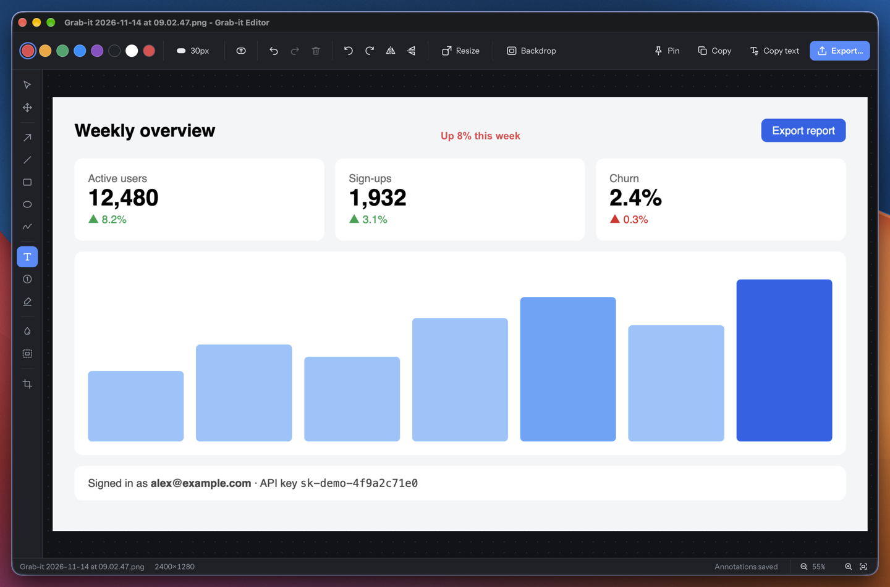

**Key: `T`**

1. Click where the text should start. A text box opens there.
2. Type.
3. Press `Enter`, or click somewhere else, to place it. `Esc` cancels.

To change text later, **double-click** it. Clearing all of it deletes it.

## Options

| Option | What it does |
| --- | --- |
| Colour | The text's colour, or the pill's in the **Pill** style |
| **Text size** | 12 to 96 pixels, 30 to start with; also `[` and `]` |
| Text style | **Plain**, **Pill**, **Outline** or **Shadow**; see below |

## Text styles

Pick one of four styles in the top bar. With a text selected, the style changes that text.

| Style | What it looks like |
| --- | --- |
| **Plain** | The text in its colour |
| **Pill** | The text on a rounded pill of its colour, in white or near-black, whichever reads better |
| **Outline** | The text in its colour, with a white or near-black edge so it stands out on any part of the screenshot |
| **Shadow** | The text in its colour, with a soft shadow under it |

Copy and export show the text exactly as the editor does.

A selected text resizes from its corners, keeping its shape. When you've turned the screenshot, text stays upright.
