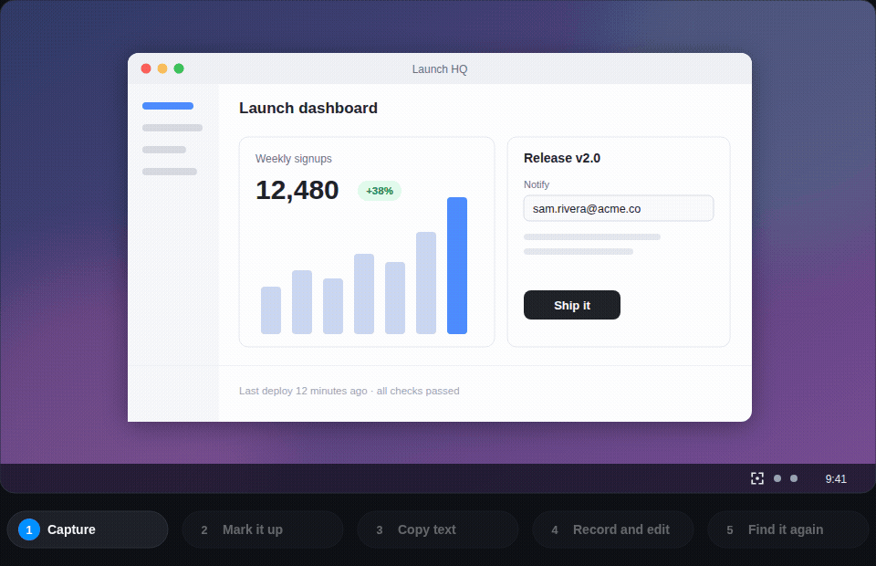

import { Card, CardGrid, LinkButton, LinkCard } from '@astrojs/starlight/components';

## Why Grab-it?

Explaining something on screen shouldn't take ten steps and three apps. With Grab-it it takes about three seconds:

1. **Press `PrintScreen`** (or `⌘ ⇧ 2` on a Mac).
2. **Drag** over what you want to share.
3. **Paste.** It's already on your clipboard.

Want to point something out first? Click **Annotate** on the little card that pops up and add arrows, boxes, numbered steps and notes. Blur the private bits, drop it on a gradient, and copy it.

## Download

Grab-it is free and open source. Pick the installer for your computer from the latest release, then follow [Install](/grab-it/get-started/install/).

<LinkButton href="https://github.com/kerwincarpede/grab-it/releases/latest" icon="seti:windows" iconPlacement="start">Windows</LinkButton>
<LinkButton href="https://github.com/kerwincarpede/grab-it/releases/latest" icon="apple" iconPlacement="start">macOS</LinkButton>
<LinkButton href="https://github.com/kerwincarpede/grab-it/releases/latest" icon="linux" iconPlacement="start">Linux</LinkButton>

## What you can do

<CardGrid>
	<Card title="Capture anything, instantly" icon="rocket">
		Grab a region, a window, one monitor or all of them, with a magnifier for pixel-perfect selections. Need time to open a menu first? Use a timed capture.
	</Card>
	<Card title="Explain it in seconds" icon="pencil">
		Arrows, boxes, highlights, text and numbered steps, each one keystroke away. Spotlight the important part and crop out the rest.
	</Card>
	<Card title="Hide what's private" icon="seti:lock">
		Blur or pixelate emails, names, tokens and anything else that shouldn't leave your screen.
	</Card>
	<Card title="Make it look good" icon="star">
		One click puts your screenshot on a gradient with padding, rounded corners and a soft shadow. Ready for slides, docs and social posts.
	</Card>
	<Card title="Find any screenshot again" icon="magnifier">
		Search every capture by the words *inside* the image, or by app, tag and date. Text recognition runs on your computer, never in the cloud.
	</Card>
	<Card title="Pin it, read it, record it" icon="seti:video">
		Float a screenshot above your windows as a reference. Copy text straight off the screen, with JSON and code tidied up by AI. Pick any colour. Record your screen.
	</Card>
</CardGrid>

## Explore the guide

<CardGrid>
	<LinkCard title="Get started" href="/grab-it/get-started/" description="Install Grab-it on Windows, macOS or Linux and keep it up to date." />
	<LinkCard title="Capture" href="/grab-it/capture/" description="Regions, windows, screens, text, colours, codes, pins and All-in-one." />
	<LinkCard title="Image editor" href="/grab-it/image-editor/" description="Arrows, boxes, steps, blur, crop, backdrops and more." />
	<LinkCard title="Recording" href="/grab-it/recording/" description="Record a region, a window or a display as an MP4 or a GIF." />
	<LinkCard title="Video editor" href="/grab-it/video-editor/" description="Trim and polish a recording before you share it." />
	<LinkCard title="Library" href="/grab-it/library/" description="Find any capture again by the text inside it, its app, tags or date." />
	<LinkCard title="AI" href="/grab-it/ai/" description="Descriptions, categories and tidied-up text from Claude Code, Codex or a local model." />
	<LinkCard title="Reference" href="/grab-it/reference/" description="Keyboard shortcuts, settings and troubleshooting." />
	<LinkCard title="Contribute" href="/grab-it/contribute/" description="Build Grab-it from source and send a pull request." />
</CardGrid>
