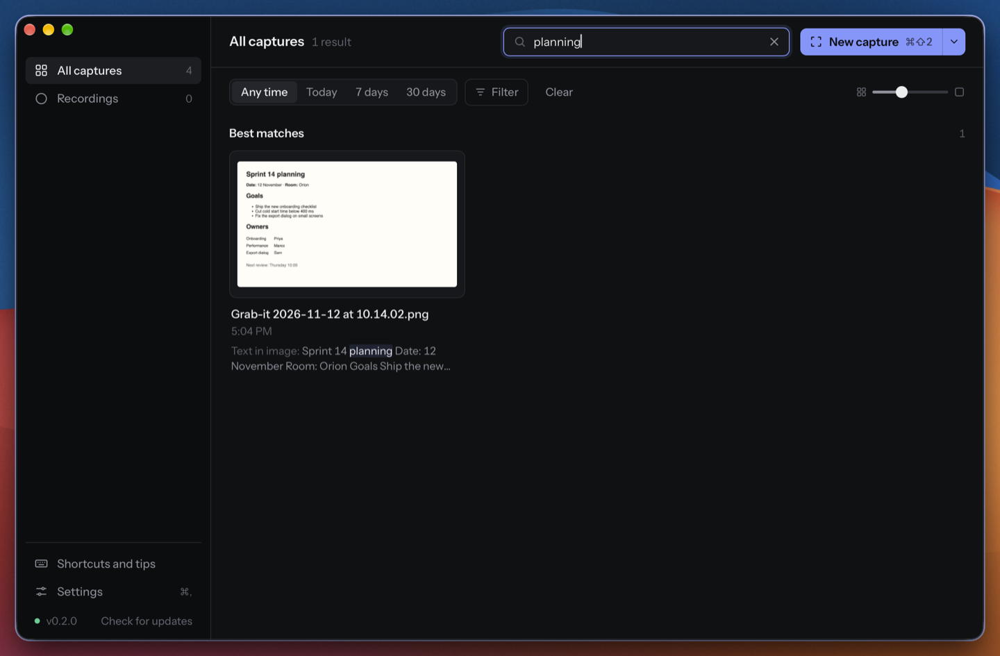

Type in the search box at the top of the Library (press `/` to jump there). Results update as you type; press `Enter` to search at once, and `Esc` to clear it.

## What search looks at

Every word you type is matched against:

- **Text in image**: the words Grab-it read in the capture.
- **Tags**: yours and the ones AI added.
- **Notes** you wrote.
- **App**: the app you captured from.
- **Window**: the window title at the time.
- **Description**: the AI description, when [AI descriptions](/grab-it/ai/descriptions/) are on.

Each result says where it matched, with the matching words highlighted, such as *Text in image: …Invoice **2026**-03…*. The best matches come first; with nothing typed, the newest captures come first.

## How words match

- **Every word must match**, somewhere in the capture. `stripe error` finds captures that have both.
- **Each word matches the start of a word.** `inv 2026` finds a receipt that says "Invoice 2026-03"; `voice` doesn't.
- Case doesn't matter, and punctuation in what you type is ignored. A "word" with no letters or digits, like `-`, is dropped.

## QR codes and barcodes

When Grab-it reads a capture's text, it also reads any QR code, Data Matrix, Aztec, PDF417 or barcode (Code 128, EAN, UPC and the rest) in it, and stores the value along with the text. So search finds a capture by the link in its QR code or the number under its barcode, even though those characters never appear as text on screen.

## Filters

The filter bar narrows any search, or the whole Library:

- **Any time**, **Today**, **7 days** and **30 days** switch the date range in one click.
- **Filters** opens the rest:
  - **Tag**: one of your tags or the AI's.
  - **Category**: the kind of capture the AI decided it is, such as *Code*, *Error / dialog* or *Receipt*. See [AI descriptions](/grab-it/ai/descriptions/#categories).
  - **Dates**: *Past 7 days*, *Past 30 days*, *This year*, or a **Custom range** with a *From* and a *To* date. Either end can be left open.
  - **Type** (Screenshots or Recordings) and **App** appear here when the sidebar isn't already choosing them.
- **Clear** turns every filter off.

The sidebar's **Apps**, **Tags** and **Recordings** combine with the search box and filters too.

## When a capture isn't found yet

Grab-it reads text in the background, one capture at a time, newest first. While it works, the Library says *Reading text in 3 captures…*. The very first time, it downloads two small text-recognition models (about 12 MB together) and shows *Downloading text recognition models…* with the progress. If the download fails, a **Retry** button appears.

Recordings are never read or described, so search finds them by their app, window title, tags and notes.

:::note
Reading the text in images happens on your computer, never in the cloud. Only the models are downloaded.
:::
