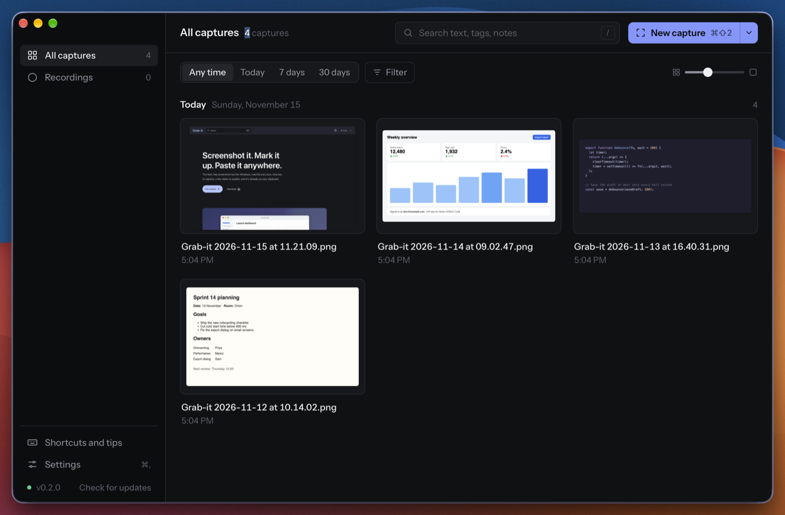

The Library is the Grab-it window: every screenshot and recording you've taken, newest first, grouped by day (**Today**, **Yesterday**, then the day of the week, then the full date).

## Open it

- Click the Grab-it icon in the menu bar or tray and choose **Open Grab-it…**, or click its Dock icon on a Mac.
- Press the **Open library** hotkey: `Alt + Shift + PrintScreen` on Windows and Linux, `⌘ ⇧ 0` on macOS.
- Open Grab-it again from your app menu while it's running.

## Browse

The sidebar on the left narrows what the grid shows:

- **All captures** shows everything, with how many there are.
- **Recordings** shows only your MP4s and GIFs.
- **Apps** lists every app you've captured from, by name, with a count. Pick one to see only its captures.
- **Tags** shows your eight most used tags, yours and the AI's. Click one to see only captures with that tag; click it again to go back.

Drag the **thumbnail size** slider at the end of the filter bar to make the tiles bigger or smaller.

Each tile shows the window title (or the file name), the app and the time. Hover a screenshot for **Copy**, **Copy text**, **Edit** and **Pin**; hover a recording for **Play**, **Edit** (MP4s only) and **Show in folder**. Double-click a screenshot to open it in the [editor](/grab-it/image-editor/mark-it-up/), an MP4 to open it in the [video editor](/grab-it/video-editor/), or a GIF to play it.

## Keyboard

| Key | What it does |
| --- | --- |
| `/` | Jump to the search box |
| Arrow keys | Move between tiles |
| `⌘ Enter` | Open the selected tile (macOS only: this one is not `Ctrl` on Windows and Linux, so double-click the tile there) |
| `Esc` | Clear the search, or close the details |

## In this section

- [Find it again](/grab-it/library/find-it-again/): search and filter by the text in an image, a QR code, a tag, a note, an app or a date.
- [Tags, notes and details](/grab-it/library/tags-and-notes/): the details panel, tagging, notes and deleting.
- [Copy text later](/grab-it/library/copy-text/): get the text out of any capture, long after you took it.
