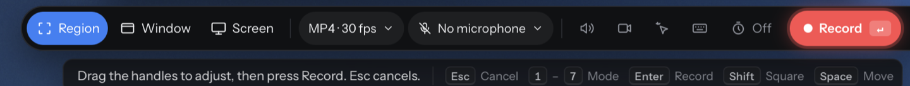

The recording setup toolbar holds the options you change most, and so does the Capture & record… toolbar while **Record** is on: a microphone button, a camera button and **Recording options**, which opens the format, system sound, noise removal, clicks and keys. Point at an item for a tooltip with its name, whether it's on and what it does; an option that's on is tinted (a grey pill in Capture & record…). When the Capture & record… toolbar is short of room, the microphone and camera buttons shrink to their icons, and their tooltips name the choice. Every change is saved to **Settings → Recording**, so the next recording starts the same way, and Settings has a few more.

## Format

The **Format** menu, first in **Recording options**, picks what the recording is saved as:

| Choice | What you get |
| --- | --- |
| **MP4 · 30 fps** | The default. Any length, with sound if you want it. |
| **MP4 · 60 fps** | Smoother scrolling and pointer movement, in bigger files. |
| **GIF · silent, 1 min** | An animated GIF at about ten frames a second. No sound, and it stops by itself after one minute. |

Wide recordings are scaled down, keeping their shape, so HiDPI recordings stay a sensible size: a GIF to at most 1280 pixels wide, and an MP4 to at most 1920 pixels wide (with both sides rounded to even numbers, as the video format needs).

An MP4 needs ffmpeg. Grab-it uses one already on your computer, or downloads one in the background (on macOS, Settings asks you to install Homebrew's). Until ffmpeg is ready, a recording is saved as a GIF and its card says why; **Settings → Recording** shows the progress.

**Settings → Recording → Quality** (Low, Medium or High, High by default) sets how sharp an MP4 is, and so how big. It applies to [exports from the video editor](/grab-it/video-editor/export/) too.

## Microphone

The microphone button records your voice with an MP4. Its menu offers:

- **Default**: the input chosen in your system's sound settings,
- any microphone connected, by name,
- or **Off**.

While you set up a recording, a bar beside the microphone icon shows how loud it hears you. Grab-it listens only while the setup toolbar is open and keeps nothing it hears. Where the system can't report a level, no bar shows.

A tick marks the current choice in the **Microphone** menu. A GIF is silent, so the chip says **No sound** and can't be changed.

## System sound

The speaker icon records what your computer plays, such as a video's sound or a notification. With the microphone on too, both are mixed into the MP4's one sound track, so it plays the same anywhere.

## Remove background noise

The sound wave icon beside the speaker cleans fan hum, keyboard clatter and room noise from your microphone, so your voice comes through clearly in a noisy room. It's off by default. Only the microphone is cleaned: system sound is left as it is.

The noise is removed on your computer when the recording is saved, with the [RNNoise](https://github.com/GregorR/rnnoise-models) model that comes with Grab-it, and nothing is sent anywhere. The sound kept apart beside the recording (below) stays as it was heard.

It needs a microphone, so it's turned off with the microphone **Off** and for a GIF. You can also turn it on in **Settings → Recording → Remove background noise**.

## Sound kept apart

Whenever an MP4 is recorded with the microphone, Grab-it also keeps its sound unmixed in a file beside it, named after it with `.sound.m4a` on the end: the microphone, and the system sound when that was recorded too, each on its own and lined up with the video. The [video editor](/grab-it/video-editor/timeline-and-trim/#sound) names them in its status bar. The file is renamed, copied, deleted and cleaned up with its recording.

Recordings made with system sound alone have no such file, since their one track already is that sound. Recordings made before Grab-it kept the sound apart have only their mixed track.

It's offered on Windows, Linux and macOS 13 or later. A GIF is silent, so it's turned off for one.

## Webcam

The camera button, beside the microphone button, shows your webcam in a bubble over the recorded area. The bubble is part of the screen, so it's recorded with it. It opens at the bottom-right corner of the area; drag it anywhere while you record. Its menu offers:

- **Default**: the camera your system picks first,
- under **Cameras**, each camera by name,
- or **Off**.

Picking a camera turns the webcam on with it; **Off** turns it off and keeps the camera chosen for next time. A camera chosen before that is no longer connected shows as **Saved camera**, and the bubble uses the default camera instead.

The names come from a list Grab-it remembers, so opening the toolbar never turns your camera on. The list is updated whenever Settings or the webcam bubble sees your cameras. To update it yourself, say after plugging a camera in, choose **Refresh camera list**: it turns the camera on for a moment to read the names, and may ask for permission to use it.

You can also pick the **Camera** in **Settings → Recording**, which also sets the **Webcam shape** (**Squircle**, the default, **Round**, **Arch**, **Pill**, **Wide** or **Blob**, which slowly changes its outline) and whether to **Mirror webcam**. Mirroring is on by default, so you see yourself as in a mirror and pointing at the screen points the right way; turn it off when there's writing behind you, which would read backwards. You can hide and show the bubble while you record from the [toolbar's menu](/grab-it/recording/toolbar/#the-menu).

## Clicks

The pointer icon draws a ring wherever you click, which grows and fades in half a second. It's drawn into the recording itself, not shown on your screen.

## Keys

The keyboard icon shows the keys you press as a label at the bottom centre of the recording, like `⌘ ⇧ 4` on macOS or `Ctrl Shift 4` on Windows and Linux. A modifier pressed on its own shows nothing. The label stays for a moment after the last key, then fades.

:::caution
On macOS, keys typed into a password field are left out. Windows and Linux can't tell when you're typing a password, so turn **Keys** off before you type one.
:::

## Countdown

The countdown button steps through **Off**, **3 s**, **5 s** and **10 s**. In Capture & record… it's in the Timer's place, and `8` steps it too. With a countdown, the recording toolbar counts down and the number shows big in the middle of the area, giving you time to get ready. Press **Cancel** on the toolbar during the countdown and nothing is recorded.

## Only in Settings

**Settings → Recording** also has:

- **Show cursor**: on by default. Turn it off to leave the pointer out of the recording.
- **Frame rate** and **Audio**: the same choices as the setup toolbar's format and sound.
- **Remove background noise**: the same as the toolbar's sound wave icon.

See [Settings](/grab-it/reference/settings/) for the rest.
