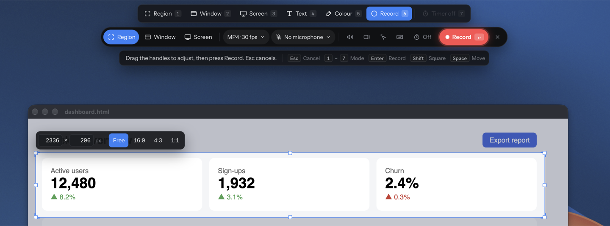

## Start

Start a recording in any of these ways:

- click the Grab-it icon in the menu bar or tray and choose **Record**,
- press the Capture & record… shortcut and pick **Record** (or press `6`),
- or start Grab-it with `--open record`, for example from a script.

The screen freezes, as it does for a screenshot. Record on its own shows the recording setup toolbar at the top. In Capture & record…, Record stays in that toolbar instead: there's no second toolbar.

Point at any item, or move to it with `Tab`, to see a tooltip with its name, its key and what it does.

## Pick what to record

There are three choices. Press `1`, `2` or `3` to switch between them, or click them. In Capture & record…, **Region**, **Window** and **Screen** in its toolbar pick what to record while **Record** is on:

- **Region**: drag an area. It stays selected so you can adjust it: drag a handle to resize it, drag inside it to move it, or set an exact size or a ratio in the chip beside it. Drag anywhere else to start a new one.
- **Window**: click a window to record the area it covers. Click another to switch.
- **Screen**: click a display to record all of it. The display under the pointer is offered first.

Record opens on the choice you used last.

The rest of the toolbar has a microphone button, a camera button, and **Recording options** (the format, countdown, devices, system sound, noise removal, clicks and keystrokes). The microphone button shows its level while you set up, so you can check it hears you before you start. In Capture & record… `8` steps the countdown. Each change is saved to **Settings → Recording** straight away, so the next recording starts the same way. See [Recording options](/grab-it/recording/options/).

When you're ready, press **Record** or `Enter`. **Record** is dimmed until you've picked something, and its tooltip says what to pick. Press **×** or `Esc` to cancel. In Capture & record…, press **Record** or `6` again to go back to screenshots.

:::tip
When you start Record on its own (from the tray's **Record** or `--open record`), drag the setup toolbar by its grip (the dots at its left end) to move it off the area you want to record. Capture & record… has no setup toolbar to move: Record stays in its own toolbar. The recording toolbar opens in the same place, and so does the setup toolbar next time.
:::

## While it records

The [recording toolbar](/grab-it/recording/toolbar/) floats over the screen with the time, Pause and Stop.

A thin dashed red outline with corner brackets marks what is being recorded. It sits just outside the area, so it never shows in the video, and clicks pass straight through it. A window's outline has rounded corners on Windows and macOS; a whole display gets brackets in its corners only. With a countdown, its big number shows in the middle of the area until the first frame.

On Windows and macOS the recording toolbar and the outline are left out of the video. On Linux (X11) the toolbar can't be hidden from it, so if it would sit on the area it opens just outside it instead.

## Stop

Stop the recording in any of these ways:

- press **Stop** on the recording toolbar,
- press the Capture & record… shortcut again, if that's how you started it,
- or choose **Stop recording** in the tray menu (the **Record** item changes to it while you record).

A GIF also stops by itself after one minute.

The toolbar shows **Saving…** for a moment, then the **Quick Access** card shows the recording with its length and size. Drag the filename in the card's details area into another app to share the MP4 or GIF. Click the preview to play it, **Show in folder** to find it, or the bin to delete it. An MP4's card also has **Edit**, which opens it in the [video editor](/grab-it/video-editor/).

If something went wrong with part of the recording, the card says so. For example, when ffmpeg isn't ready yet an MP4 is saved as a GIF instead (see [Recording options](/grab-it/recording/options/#format)), and when a sound couldn't be recorded the video is kept with the sound that worked.

Every recording also goes into your [Library](/grab-it/library/), where double-clicking an MP4 opens it in the video editor.

:::note
Quitting Grab-it while it records finishes the recording first, so the file is complete.
:::
