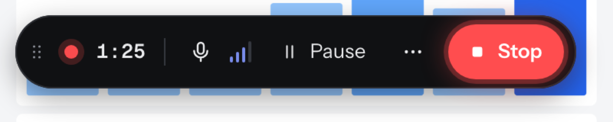

While you record, a small toolbar floats over the screen. On Windows and macOS it's left out of the video, so it never shows in your recording.

From left to right it shows:

- a pulsing red dot, **Recording** and the time recorded so far (a GIF also shows its one-minute limit, like `0:12 / 1:00`),
- a small level meter and the microphone button, when you record a microphone,
- **Pause**,
- **⋯**, which opens the menu,
- and a red **Stop**.

When the toolbar has the focus, `Enter` stops and saves and `Space` pauses or resumes. `Esc` never stops or throws away a recording.

## Mute

Click the microphone to mute it, and again to turn it back on. While it's muted, silence is recorded in its place, so the video and its sound stay in step. The meter before it shows how loud the microphone is, so you can tell it's working.

When you record the system sound but no microphone, the button mutes the system sound instead. The [menu](#the-menu) mutes either one.

## Pause

Click **Pause** to stop recording for a while, for example while you set up the next step. The dot turns amber and stops pulsing, **Recording** changes to **Paused**, the time stops and blinks, and **Pause** slides to **Resume**. Nothing is recorded until you click **Resume**, and the time you were paused is left out of the video.

## Stop

Click **Stop** to finish and save the recording. You can also press the Capture & record… shortcut again if that's how you started it, or choose **Stop recording** in the tray menu. A paused recording stops straight away.

The toolbar shows **Saving…** until the file is done, then the Quick Access card shows the recording. See [Record your screen](/grab-it/recording/record/#stop).

## The menu

Click **⋯** for the rest:

| Item | What it does |
| --- | --- |
| **Microphone** | Turn the microphone on or off. Shown when you record one. |
| **System sound** | Turn the system sound on or off. Shown when you record it. |
| **Webcam** | Show or hide the webcam bubble. It works even if you started without it. |
| **Restart** | Throw away what you've recorded so far and start again on the same area, with the countdown if you have one. |
| **Discard** | Throw the recording away and stop. Nothing is saved. |
| **Move back to the top** | Put the toolbar back at the top centre of the screen. |

**Restart** isn't available during the countdown. Once the toolbar says **Saving…**, the menu can't be opened.

## The countdown

With a [countdown](/grab-it/recording/options/#countdown) on, the toolbar shows **Recording in** and the seconds left before the first frame, beside a red ring that empties as each second goes.

- Click **Start now**, or press `Enter`, to skip the rest of the countdown and start recording at once.
- Click **✕** (Cancel recording), or press `Esc`, to stop without recording anything.

## Move it

Drag the toolbar by any part that isn't a button. Grab-it remembers where you left it on each display, as a distance from the nearest corner, so it stays put when you change the resolution. The next recording opens it on the display you last left it on, if that's still connected, or else on the display you're recording, at the spot saved for it. With no spot saved, it opens at the top centre.

Moving the setup toolbar before you start (by its grip) sets where the recording toolbar opens, too. The grip is there only when Record is started on its own (the tray's **Record** or `--open record`), not from the Capture & record… toolbar.

:::note
On Linux (X11), the toolbar can't be hidden from the recording. If it would sit on the area you're recording, Grab-it moves it just outside when it opens. Move it clear of the area yourself if you drag it back in.
:::
