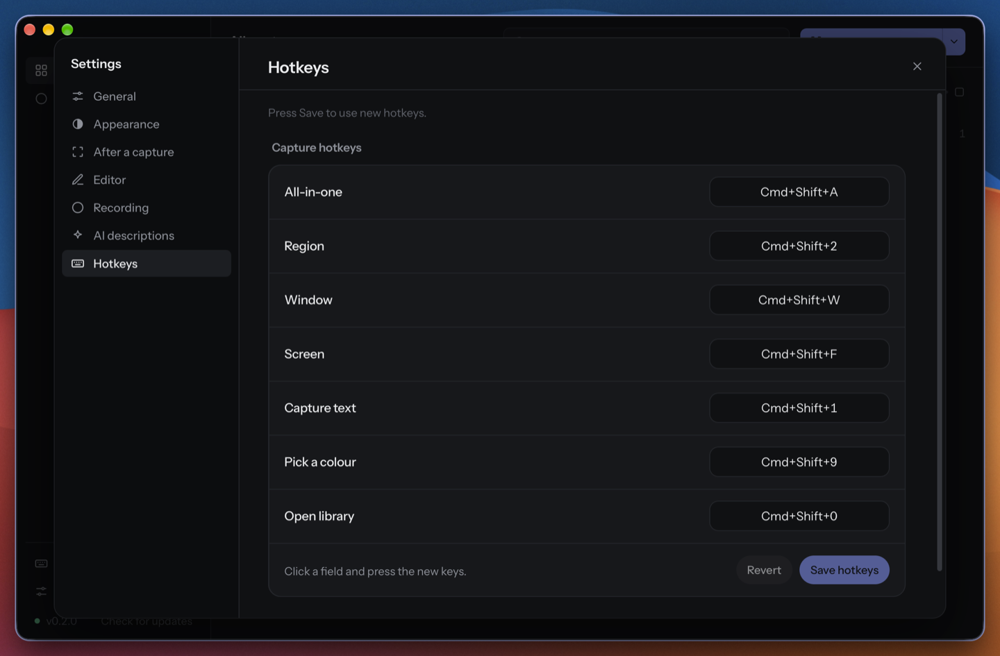

Open **Settings** from the Grab-it window's sidebar, with `⌘ ,` (`Ctrl + ,` on Windows and Linux) in the Grab-it window, from the gear in the Grab-it panel, or from **Settings…** in the tray menu. Settings has a page for each part of Grab-it, listed on its left.

Most changes save as soon as you make them. Hotkeys save when you press **Save hotkeys**, and an AI endpoint's URL, model and key when you press **Save**.

## General

| Setting | Default | What it does |
| --- | --- | --- |
| **Show Grab-it in the Dock** (macOS) | On | Click the Dock icon to open the Grab-it window. Off, Grab-it lives in the menu bar only. |
| **Start Grab-it when you sign in** | Off | It waits in the menu bar or tray, ready for your hotkeys. |
| **Save folder** | `Pictures/Grab-it` | New captures are saved here; click **Change…** to pick another. Earlier captures stay where they are and stay in your Library. Recordings go in its `recordings` folder. Export dialogs open here until you choose an export folder. The image editor, Library and guide then remember that folder together. |
| **Update channel** | Stable | Which releases Grab-it updates to. **Stable** gets updates after they’ve been tried on Edge. **Edge** gets new features and fixes sooner, with a higher chance of bugs, and shows an **Edge** badge by the version. Leaving Edge keeps your version until Stable passes it. See [Updates](/grab-it/get-started/updates/#stable-and-edge). |

## Appearance

**Text size**

| Setting | Default | What it does |
| --- | --- | --- |
| **Grab-it window** | 110% | Scales the Library, Settings and every dialog: text, buttons and thumbnails, from 85% to 130% in steps of 5. `⌘ +`, `⌘ −` and `⌘ 0` (`Ctrl` on Windows and Linux) change it too. |
| **Menu bar hub** | 110% | The panel under the Grab-it icon grows with it. |

**Popup after a capture**

| Setting | Default | What it does |
| --- | --- | --- |
| **Position** | Bottom right | Which corner of the screen the Quick Access card appears in. |
| **Show it for** | 8 seconds | 3, 5, 8, 12, 20 or 30 seconds, or *Until I close it*. Resting the pointer on it keeps it open. Errors stay at least 10 seconds. |

## After a capture

**When a capture is done**, Grab-it can:

- **Show Quick Access** (the default): a small preview in the corner with Copy, Annotate, Pin and more. It goes away by itself.
- **Open the editor**: go straight to annotating every capture.
- **Do nothing**: save quietly. Find the capture in the Library or with the tray's **Show last capture**.

**Copy every capture to the clipboard** (on by default) lets you paste it straight into a chat, a document or an issue.

**Play a sound when copying** (on by default) plays a Holga shutter sound when
Grab-it successfully copies to the clipboard. It covers captures and manual
copies from the editor, Library and Quick Access, including text, codes,
colours, file paths, files and guides. A capture saved without copying and an
automatic AI replacement of text already copied by OCR are silent.

**Volume** (50% by default) sets how loud the sound plays, from 0% to 100%.
It saves when you let go of the slider and stays available while the switch is
off. At 0% nothing plays. Turning the sound off keeps it off after updates.

Select the play button beside the switch, **Preview sound**, to hear it at the
chosen volume while the switch is off or on. Both clipboard confirmations and
preview are silent during countdown, recording and pause, and the play button
is unavailable then.

## Editor

**Frame new captures with the last backdrop** (off by default): the [editor](/grab-it/image-editor/mark-it-up/) adds the backdrop you used last when it first opens a capture. The saved capture and its clipboard copy stay unframed.

**Show the pointer in new captures** (off by default): the [editor](/grab-it/image-editor/pointer/) starts with the capture's mouse pointer shown, and the clipboard copy made when you capture has it drawn in. The saved capture never has it, and you can show or hide it in the editor whichever way this is set.

## Recording

| Setting | Default | What it does |
| --- | --- | --- |
| **Save recordings as** | MP4 video | **MP4 video**: smooth video with no time limit, small enough to share. **GIF**: plays anywhere an image does; silent, about 10 fps, and at most a minute. |
| **Quality** (MP4) | High | Low, Medium or High. Higher quality looks sharper and makes bigger files. |
| **Frame rate** (MP4) | 30 fps | 30 or 60 fps. 60 fps makes scrolling and pointer movement smoother, and files bigger. |
| **Video encoder** (MP4) | | Whether ffmpeg is ready, and which encoder it uses. See below. |
| **Audio** | None | None, Microphone, System sound, or Microphone and system sound. GIFs are silent. System sound is offered on Windows, Linux and macOS 13 or later. |
| **Microphone** | System default | Which microphone, when Audio records one. System default follows the input chosen in your sound settings. |
| **Remove background noise** | Off | Cleans fan hum, keyboard clatter and room noise from the microphone when the recording is saved. System sound is left as it is. Needs a microphone, and GIFs are silent. |
| **Show cursor** | On | Draws the pointer into the recording. |
| **Show clicks** | Off | Draws a ring where you click, fading in half a second. |
| **Show keystrokes** | Off | Shows the keys you press at the bottom of the recording. |
| **Show webcam** | Off | Shows your camera in a bubble over the recorded area, recorded with it. Drag it anywhere while recording. |
| **Camera** | System default | Which camera, when Show webcam is on. |
| **Webcam shape** | Squircle | Squircle, Round, Arch, Pill, Wide or Blob. |
| **Mirror webcam** | On | Shows you as a mirror would. Turn it off when there's writing behind you. |
| **Countdown** | Off | Off, 3, 5 or 10 seconds, counted down on the recording toolbar before the first frame. |

**Show keystrokes and passwords.** On macOS, keys you type into a password field are left out, and the first recording with clicks or keystrokes on asks for **Input Monitoring** permission. Windows and Linux can't tell when you're typing a password, so turn **Show keystrokes** off before you type one.

**Video encoder.** MP4 needs ffmpeg, which isn't shipped with Grab-it. Grab-it uses one already on your computer, or downloads a build the first time you record an MP4, showing *Downloading ffmpeg…* here. On macOS, where there's no build to download, it asks you to install one with `brew install ffmpeg` and press **Retry**. Until ffmpeg works, recordings are saved as GIFs. Once it's ready, this row says which encoder it found, hardware encoders first.

## AI integration

AI providers and AI agents share one page. Changes to the provider and its switches take effect when you press **Save**; **Cancel** puts back what was saved. The agent settings save at once.

| Setting | Default | What it does |
| --- | --- | --- |
| **Use an AI provider** | Off | Lets Grab-it use the provider below. Off, nothing is sent. |
| **Describe captures with AI** | Off for a new setup | A vision model writes a short description, picks a category and adds up to three short tags, so you can search for what is in a capture. |
| **Only describe new captures** | On | Leaves earlier captures alone. Turn it off to describe the whole library: Save first says how many screenshots that is. |
| **Tidy up captured text** | Off for a new setup | After Capture text, the AI reads the text again, fixes what was misread, and lays out JSON, code and tables. |

**Described by** picks the provider: **Claude Code**, **Codex** or **OpenAI-compatible endpoint**, with its **Model**, and for an endpoint its **Preset** (LM Studio, Ollama, OpenRouter, OpenAI, Anthropic or Custom), **Endpoint URL** and **API key**. **List models** suggests the models the endpoint offers. **Test connection** checks the settings as typed, with a built-in test image, without saving them, and says where it sends it first. See [Providers](/grab-it/ai/providers/).

**Your library → Analyse all again…** says how many screenshots it will describe, then describes every capture again, replacing the current descriptions. **Cancel** in the Library stops it.

Settings from an earlier version are kept: a provider you had on stays on, with the same model, API key and switches.

**AI agents**

| Setting | Default | What it does |
| --- | --- | --- |
| **Let AI agents use Grab-it** | Off | Lets the [grab-it commands](/grab-it/reference/command-line/#commands) list your displays and windows, take screenshots, record the screen and make GIFs and contact sheets from videos. Shots go to the Library tagged **agent**, with a notice for each. Off, every command fails with a message saying how to turn it on. |

**Agent skill → Install skill** writes the skill that teaches Claude Code, Codex and other agents the commands, to `~/.agents/skills/grab-it` and `~/.claude/skills/grab-it`. The row says where it's installed. See [AI agents](/grab-it/ai/agents/).

## Hotkeys

**Capture hotkeys** lists **Capture & record…**, **Region**, **Window**, **Screen**, **Capture text**, **Pick a colour**, **Open library** and **Step capture**. Click a field and press the new keys; `Tab` moves to the next field as usual. While a field has focus your hotkeys are paused, so pressing one records it instead of taking a capture.

Press **Save hotkeys** to use them, or **Revert** to go back. Grab-it refuses an empty hotkey, one it can't use, or the same keys for two actions. If another app already holds a hotkey, Settings says which one couldn't be registered; the tray menu always works.

The defaults for each system are in [Keyboard shortcuts](/grab-it/reference/keyboard-shortcuts/).

:::note[Linux on Wayland]
Your desktop binds Grab-it's hotkeys. After changing them, restart Grab-it to offer the new ones, then confirm them in your desktop's shortcut settings.
:::

## Where settings are kept

Settings are saved as `settings.json` in Grab-it's app data folder (`com.kerwincarpede.grabit`). Missing settings fall back to their defaults, so a settings file from another version still loads. An endpoint API key is kept in your system keychain, not in that file, wherever there is one.
