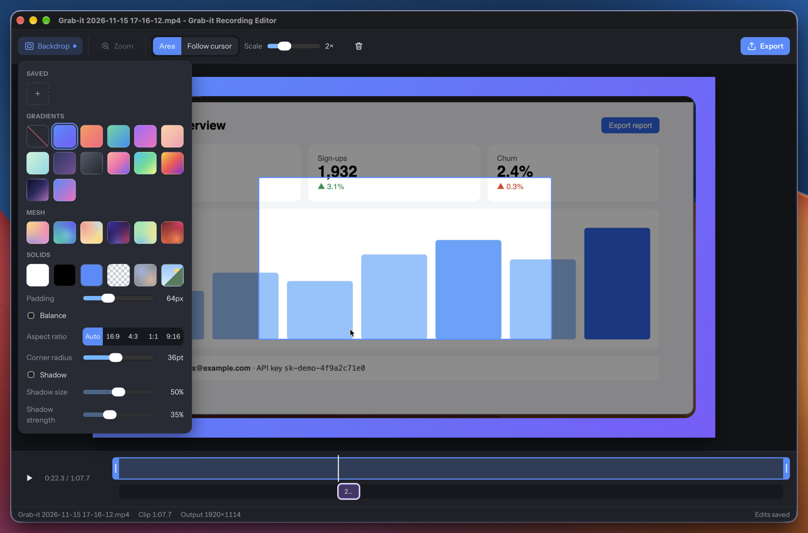

**Backdrop** in the top bar puts your recording on a background, as it does for a screenshot in the [image editor](/grab-it/image-editor/). It's also how you change the video's shape: its aspect ratio sets the shape of the export.

Click **Backdrop** to open its panel. Click outside it or press `Esc` to close it. The preview shows each change straight away.

## Fill

Pick what goes behind the video:

- **No backdrop**: the first swatch, crossed out. The export is just the recording, trimmed and zoomed.
- **Gradients**: Ocean, Sunset, Aurora, Grape, Peach, Mint, Dusk, Slate, Flamingo, Lagoon, Ember and Nebula, and a **Custom gradient** with your own start and end colours and angle.
- **Mesh**: Bloom, Tide, Sorbet, Midnight, Meadow and Glow, soft blends of colour.
- **Solids**: White, Black, or any colour from the colour picker.
- **Transparent**: a video can't be see-through, so this shows as black.
- **Blurred capture**: a blurred copy of the frame filling the background. It's painted from the frame on show, so the export uses the frame the playhead is on when you click **Export**.
- **Image**: choose a picture of your own. Click it again to choose another.

Picking a fill while the backdrop is off starts from the sizes of the last backdrop you used.

## Size and shape

| Control | What it does |
| --- | --- |
| **Padding** | The space around the video, 0 to 200 pixels of the recording. |
| **Aspect ratio** | **Auto** fits the backdrop to the video and its padding. **16:9**, **4:3**, **1:1** and **9:16** widen or heighten the backdrop to that shape, with the video in the middle. Use **9:16** for phone-shaped videos and **1:1** for square posts. |
| **Corner radius** | How round the video's corners are, up to 80. |
| **Shadow** | A soft shadow under the video, with its **Shadow size** and **Shadow strength**. |

**Balance**, which centres a screenshot with uneven margins, has no effect on a recording.

The status bar shows the size the export will have, like **Output 1920×1080**. An export's longer side is at most 1920 pixels, so a large recording on a backdrop is scaled down to fit, and both sides are rounded to even numbers, as MP4 needs.

## Presets

**Saved**, at the top of the panel, holds backdrops saved by name. They're shared with the image editor, so a preset saved in one shows in the other.

- Click **+** to save the backdrop on show. An image fill is copied, so the preset keeps working if you move the picture.
- Click a saved swatch to use it. Its name shows under the swatches: type to rename it, or click **Delete** to remove the preset (the backdrop on show stays).

You can keep up to 24 presets.
