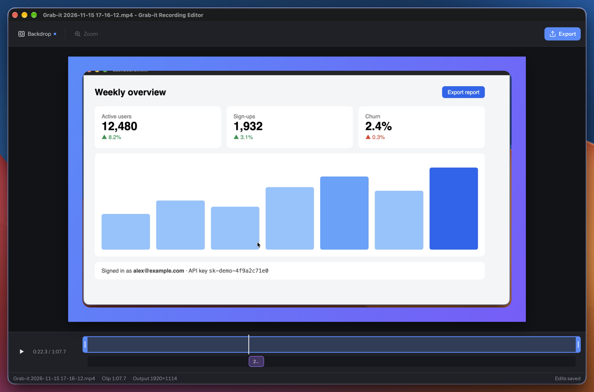

The video editor polishes an MP4 [recording](/grab-it/recording/) before you share it: cut its start and end, join other recordings to it, put it on a backdrop with rounded corners and a shadow, and zoom in on the parts that matter. Export saves the result as a new MP4 beside the recording.

## Open a recording

- When an MP4 recording stops, click **Edit** on its Quick Access card.
- In the [Library](/grab-it/library/), double-click a recording, or click its edit button.

GIFs can't be edited: the card for one has no **Edit**.

## What's where

- **Top bar**: **Undo** and **Redo**, **Recording**, **Backdrop**, **Zoom**, **Captions**, the selected zoom's or caption's controls, and **Export** on the right.
- **Middle**: the preview, showing the recording on its backdrop with its zooms, as the export will look.
- **Bottom**: play and pause, the time, the [timeline](/grab-it/video-editor/timeline-and-trim/) with its trim handles, or the clips once you [join recordings](/grab-it/video-editor/join-recordings/), the [sound tracks](/grab-it/video-editor/tracks/), and the zoom and caption rows under it.
- **Status bar**: the file name, how long the trimmed clip is, the size the export will have, and whether your edits are saved.

## Your edits are safe

Every change is saved as you make it, in a small file beside the recording, so you can close the editor and carry on later. The status bar says **Edits saved**. The recording itself is never changed: edits are only rendered into the new file when you export. See [Export](/grab-it/video-editor/export/).

## Undo and redo

Every trim, clip, backdrop and zoom change is one step you can undo. Click **Undo** or **Redo** in the top bar, or press `Ctrl Z` (`⌘ Z` on macOS) to undo and `Ctrl Shift Z` or `Ctrl Y` (`⌘ ⇧ Z` or `⌘ Y` on macOS) to redo. Dragging a handle, a zoom or a slider is one step, made when you let go.

Each undo and redo is saved straight away, like any other edit. The steps last while the editor is open: when you open the recording again, it starts from the edits as they were saved, with nothing to undo.

## Pages in this section

- [Timeline and trim](/grab-it/video-editor/timeline-and-trim/): play, seek and cut the start and end.
- [Backdrop and shape](/grab-it/video-editor/backdrop/): fills, padding, aspect ratio, corners and shadow.
- [Zooms](/grab-it/video-editor/zooms/): zoom in on an area or follow the pointer.
- [Export](/grab-it/video-editor/export/): where the new MP4 goes, and what's left untouched.
- [Join recordings](/grab-it/video-editor/join-recordings/): add other recordings, reorder them and trim each one.
- [Suggest edits](/grab-it/video-editor/suggest-edits/): cut the pauses Grab-it finds, and compare the sound before and after noise removal.
- [Captions](/grab-it/video-editor/captions/): transcribe the speech into captions, correct them, and burn them into the export.
- [Tracks and sound](/grab-it/video-editor/tracks/): unlink a recording's sound from its picture, move it in time, and link it again.
