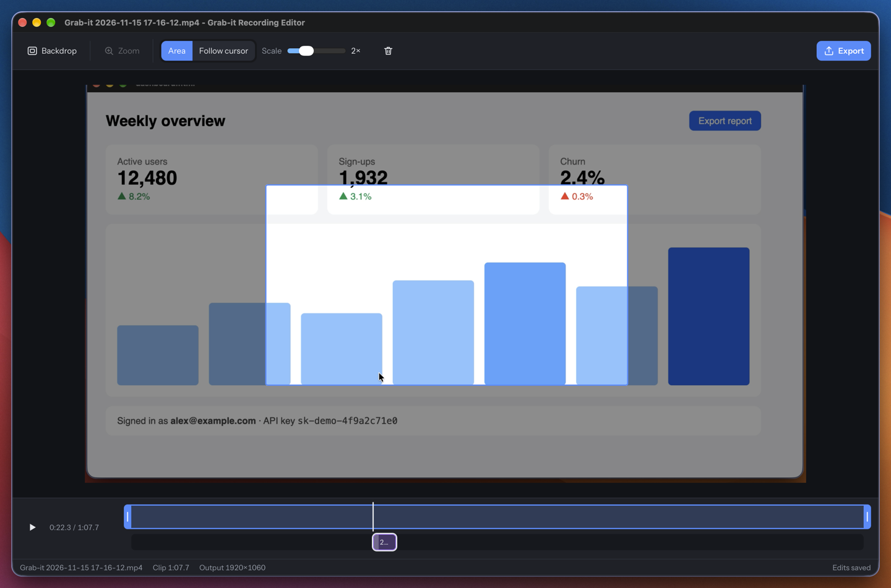

A zoom shows a stretch of the recording larger, so a small button or a line of text is easy to see. It eases in, holds, and eases back out. Each zoom either stays on an **area** you choose or **follows the pointer**.

Zooms sit on the row under the timeline, each as a segment labelled with its scale and focus, like **2× Area** or **2× Cursor**. The preview plays them as the export will.

## Add a zoom

- Move the playhead to where the zoom should start and click **Zoom** in the top bar.
- Or double-click an empty stretch of the zoom row.

A new zoom is 2 seconds long, at **2×**, on an area in the middle of the frame. It's shorter when the next zoom or the end of the recording is closer, and it's selected straight away so you can set it up.

Zooms never overlap. **Zoom** is greyed out while the playhead is inside a zoom, or when the gap there is shorter than half a second: move the playhead clear of the other zooms first.

## Select it

Click a zoom on the row to select it. Its controls show in the top bar:

- **Area** or **Follow cursor**: what the zoom centres on.
- **Scale**: how far it zooms in.
- the bin, to delete it.

Click an empty part of the row, or press `Esc`, to deselect it.

## Area or pointer

**Area** zooms in on a part of the frame you choose. While an area zoom is selected and the video is paused, the preview shows the whole frame with the zoomed area outlined and the rest dimmed:

- click or drag anywhere on the preview to centre the area there,
- or use the arrow keys to nudge it, ten times as far with `Shift`.

The area always stays inside the frame. Switching a zoom to **Area** starts it where the pointer was when the zoom begins.

**Follow cursor** keeps the pointer in view as it moves. The pointer's path is smoothed, so the view glides rather than jitters, and it never leaves the frame: near an edge, the view stops at the edge and the pointer moves off-centre.

Following the pointer needs the pointer track Grab-it saves with each MP4 it records. An exported video has none, so **Follow cursor** is greyed out for one and says *This recording has no pointer track*.

## Scale

Drag the **Scale** slider from **1.25×** to **4×**, in steps of 0.25. The number beside it shows the scale. An area zoom's area shrinks as you zoom further in, and moves back inside the frame if it has to.

## Easing

Every zoom eases in over its first 0.3 seconds and back out over its last 0.3 seconds, starting and ending gently. A zoom shorter than 0.6 seconds spends half its time easing in and half easing out. The shortest zoom is half a second.

## Move and resize it

- Drag a zoom along the row to move it, keeping its length.
- Drag its left or right edge to make it start earlier or end later. The preview shows the frame at that edge as you drag.
- With a zoom selected, the `←` and `→` keys move it a tenth of a second, or a whole second with `Shift`.

A zoom stops where it meets its neighbours or the ends of the recording.

Zooms belong to the recording, not the trimmed clip: [trimming](/grab-it/video-editor/timeline-and-trim/#trim) leaves them where they are, and any part of a zoom outside the trim is left out of the export with the rest.

## Delete it

Select the zoom and click the bin in the top bar, or press `Delete` or `Backspace`. **Undo** brings it back, as it does for adding, moving or changing a zoom.
